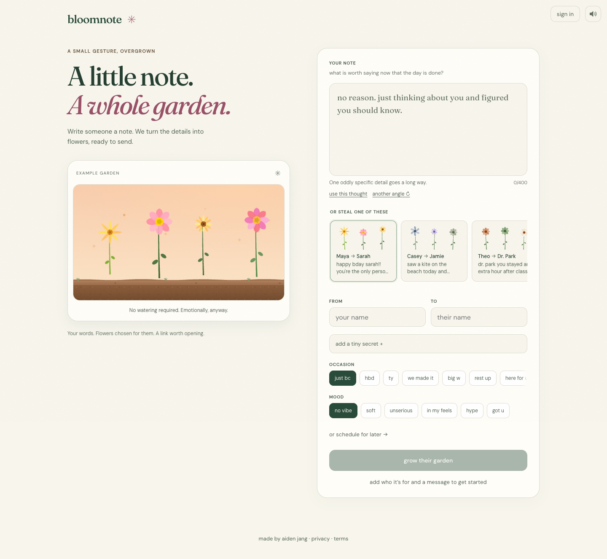

# Bloomnote

Write someone a personal note. Bloomnote turns its details into a small garden of flowers,
each with a meaning, and gives you a link that blooms when they open it.

[Open Bloomnote](https://bloomnote.aidenjang.com)



## The experience

- Write a note, choose an occasion and mood, and grow a garden.
- Send its short link, save an image, or choose different flowers.
- The recipient opens the garden, reads your words, explores the flowers, and can grow one back.
- Add a little secret or schedule the reveal for a later moment.
- Keep gardens on this device, or sign in to sync your sent and received collections. Failed
  account removals restore the entry; sharing failures keep a selectable link available.

An account is optional. Shared sign-in comes from the [platform auth service](https://github.com/aiden-jang/auth).
The UI uses React and SVG; a Hono Worker serves the API and built web app together. Gemini designs
the flowers, Cloudflare KV stores gardens, and a Durable Object enforces request and spending limits.

## Run locally

Use Node 22 and `pnpm`, using the version pinned in `package.json`.

```bash
nvm use
corepack enable
pnpm install --frozen-lockfile
```

In two terminals, from the repository root:

```bash
pnpm run dev:api
pnpm run dev:web
```

Open [localhost:32100](http://localhost:32100). The API listens on port 32200.
Real generation needs `GEMINI_API_KEY` in `packages/api/.dev.vars`; keep that file untracked.
The app handles an unavailable key with a recoverable error. Local account integration uses the
separate auth service on port 34100; anonymous composition works without it.

## Verify a change

```bash
pnpm --filter @bloomnote/web exec playwright install --with-deps chromium webkit
pnpm run verify
```

This runs repository guards, types, lint with no warnings, formatting, CSS checks, documentation
checks, unused-code detection, a complete dependency audit, guard tests, builds, API and frontend
unit tests, a bundle report, and desktop Chromium plus iPhone-sized WebKit journeys. CI runs the same checks, with browser
journeys in a parallel job. The tests stub Gemini and do not spend its quota. WebKit emulation
does not verify a physical phone’s keyboard, gestures or native share sheet.

`pnpm run verify:fast` runs everything except the browser suite. The normal browser suite starts
its own local servers and refuses to reuse a manually running app, so stop local development first.

Prompt evaluation is separate: `pnpm --filter @bloomnote/api eval` makes real Gemini requests.
Use it when changing the prompt, after checking the run’s printed call budget and available quota.

## Privacy and limits

Your note is sent to Google’s Gemini for design and stored with the garden. **Anyone with the
link can read the garden.** The random short link is its access token; it is not an account-only
sharing boundary. Private garden, image, and account routes ask search engines not to index them.
The scheduled reveal is a presentation feature, not encryption or access control.

Gardens do not expire. Removing one from your library removes the library entry and leaves its
shared link working. Drafts, pins, memories, and anonymous library entries are stored on this
device; account collections are stored on the server. See the app’s [privacy page](https://bloomnote.aidenjang.com/privacy).

Generation depends on Gemini availability and the configured daily budget. A failed generation
keeps your note. A failed account-library load offers retry rather than pretending the library is
empty, and sharing failures leave the garden and its link available.

## Repository guide

| Area                           | Responsibility                                                         |
| ------------------------------ | ---------------------------------------------------------------------- |
| `packages/web/src/components/` | Writing desk, recipient reveal, library, and SVG presentation          |
| `packages/web/src/lib/`        | Pure decisions, storage helpers, sharing, and lifecycle hooks          |
| `packages/api/src/`            | Routes, garden storage, auth boundary, model design, and atomic limits |
| `packages/api/test/`           | Tests in the actual Workers runtime                                    |
| `packages/web/e2e/`            | Browser journeys and recovery regressions                              |
| `scripts/`                     | Repository guards and bundle reporting                                 |
| `.github/`                     | CI, dependency updates, contribution templates, and security policy    |

- [Architecture and decisions](ARCHITECTURE.md)
- [Contributing and checks](CONTRIBUTING.md)
- [Deployment and recovery](DEPLOY.md)
- [UI design](DESIGN.md) and [visual verification](docs/quality.md)
- [Engineering conventions](CONVENTIONS.md)
- [Visitor walkthrough](docs/visitor-review.md)
- [Security reporting](.github/SECURITY.md)

Released under the [MIT license](LICENSE).

Installed apps can offer **Write a note**, which opens and focuses the existing
composer without clearing its saved draft. Browser titles identify the composer,
library, or garden without putting the note or secret in the tab. Current public
composer screenshots in `packages/web/public/screenshots/` supply phone and desktop
install previews; capture the running composer again when its layout changes.

Aggregate traffic and feature-event coverage, privacy boundaries and queries: [Analytics](docs/ANALYTICS.md).
